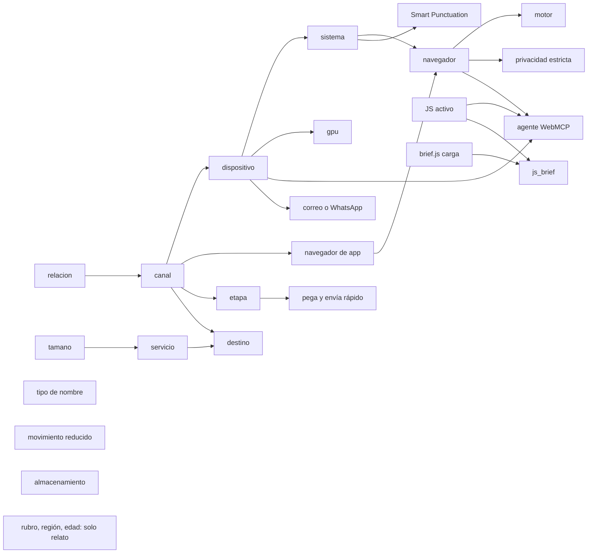
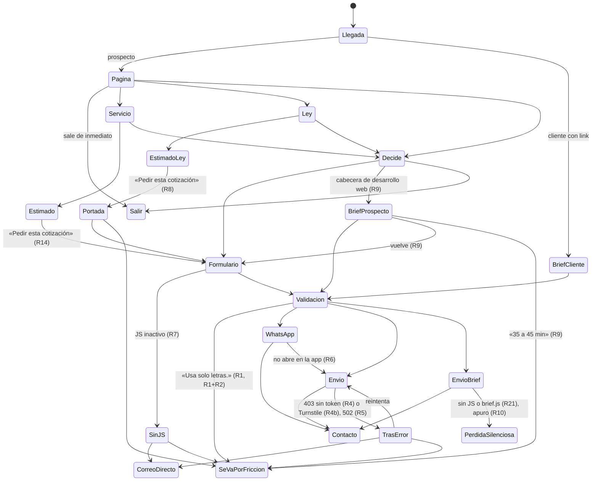

# Modelo: variables, probabilidades y cadena de uso

Segundo paso del caso ([recorrido](recorrido.md) → modelo → [perfiles](perfiles.md) →
[usuarios y flujos](usuarios-y-flujos.md) → [resultados](resultados.md)). El modelo separa tres cosas:

| Qué | De dónde sale | Ejemplo |
|---|---|---|
| **Soporte** (qué valores existen) y **restricciones duras** (qué combinación es imposible) | El código, con `archivo:línea` | «Enviar por» solo admite correo o WhatsApp (`src/components/Contacto.jsx:93-114`) |
| **Pesos** (qué tan probable es cada valor) | Anclas públicas cuando las hay; si no, un prior del LLM con p10, p50 y p90 | iOS es el 20,72 % de los celulares en Chile (StatCounter, oct-2026) |
| **Calibración** | Datos reales, cuando existan (hoy no: el sitio no usa analítica) | Actualización Dirichlet-multinomial ([resultados](resultados.md#calibración)) |

Todas las cifras **describen el modelo, no el mercado**.

## Pregunta de la corrida

¿Qué usuarios no logran cotizar ni contactar a Volutus, en qué paso y por qué? ¿Qué entornos técnicos rompen la
experiencia?

## Anclas públicas

| Ancla | Valor | Fuente |
|---|---|---|
| Plataforma en Chile | Escritorio 50,05 %, celular 49,12 %, tablet 0,84 % | [StatCounter, oct-2026](https://gs.statcounter.com/platform-market-share/desktop-mobile-tablet/chile) |
| Sistema del celular | Android 79,28 %, iOS 20,72 % | [StatCounter, oct-2026](https://gs.statcounter.com/os-market-share/mobile/chile) |
| Sistema del escritorio | Windows 85,02 %, macOS 8,80 %, Linux 5,87 % | [StatCounter, oct-2026](https://gs.statcounter.com/os-market-share/desktop/chile) |
| Navegador | Chrome 77,32 %, Safari 9,27 %, Edge 5,24 %, Opera 2,69 %, Firefox 2,54 %, Samsung 1,73 % | [StatCounter, oct-2026](https://gs.statcounter.com/browser-market-share/all/chile) |
| Tamaño de empresa (con ventas, 2024) | Micro 74,2 %, pequeña 21,2 %, mediana 3,1 %, grande 1,5 %; RM cerca del 43 % | [SII, Estadísticas de empresas](https://www.sii.cl/sobre_el_sii/estadisticas_de_empresas.html), vía BCN e INE 2025 |
| Agentes con WebMCP | Origin trial de Chrome (149 a 156, extendido a 162) y de Edge; Safari se opone | Fuentes en [viabilidad](../viabilidad.md#fuentes) |

Las anclas de StatCounter son de **todo el tráfico de Chile**. Para este público, dueños de negocios que llegan por
redes o por un link de WhatsApp, el modelo sube el peso del celular **solo en esos canales** (prior del LLM). Por eso el
total queda en 56 % de celular.

## La red de perfiles

Las variables de relato (rubro, región, edad) no cambian el flujo, porque el código no depende de ellas. Se sortean para
que la ficha sea coherente y quedan marcadas así. Es la lección de la v0: allí las necesidades no se vinculaban con
nada y aun así parecían explicar algo.

### Variables

| Variable | Soporte (del código) | Pesos p50 | Rango o κ | Fuente del peso |
|---|---|---|---|---|
| Relación | Prospecto o cliente con el link del brief (`src/lib/meta.js:301-310`) | Cliente 5 % | 2–10 % | Prior LLM |
| Canal de llegada | Google, artículo, recomendación, redes, directo, asistente de IA (el sitio deja leer a los agentes: `public/robots.txt:4`) | 32 / 14 / 20 / 14 / 8 / 12 % | κ = 15 | Prior LLM. La verificación encontró que la lista sumaba 0,94 y el resto caía en «asistente de IA»; se declaró ese 12 %, que es con lo que corrió el modelo. |
| Dispositivo | Breakpoints S a XL y diseño para celular (`CLAUDE.md:102-119`) | Ancla de StatCounter; celular 80 % si llega por redes y 70 % por recomendación | κ = 200 en el ancla | Ancla + prior |
| Sistema y navegador | WebKit obligado en iOS y iPadOS; Safari 18 en iPad (`CLAUDE.md:124`) | Anclas de StatCounter | κ = 30–200 | Ancla + prior |
| Navegador de app | Instagram o Facebook, celular y canal redes | 60 % de esos | 40–80 % | Prior LLM |
| Movimiento reducido | `src/lib/movimiento.js:7` | 5 % | 2–10 % | Prior LLM |
| GPU | ok, lenta o sin WebGL (`src/comportamiento/nubes.js:44-56`) | Escritorio 86 / 12 / 2 %; celular 92 / 7 / 1 % | κ = 20 | Prior LLM |
| JS inactivo | `src/components/Contacto.jsx:23-25`, `worker/index.js:34-40` | 0,5 % | 0,2–1,5 % | Prior LLM |
| `brief.js` no carga | `src/client.js:299-302` | 0,5 % | 0,1–2 % | Prior LLM |
| Sin almacenamiento | `src/lib/almacen.js:1-3` | 3 % | 1–6 % | Prior LLM |
| Privacidad estricta | `worker/comun.js:130-152` | 3 % (× 5 en Firefox) | 1–6 % | Prior LLM |
| Agente WebMCP | Escritorio, Chrome o Edge, con JS (`src/components/Contacto.jsx:40-43`); sin token de origin trial | 0,2 % de esos | 0,05–1 % | Prior LLM + estado de WebMCP |
| Smart Punctuation | iOS y iPadOS | 95 % | 85–99 % | Prior + comportamiento documentado |
| Tipo de nombre | Simple, con apóstrofo, con guion o punto, de empresa (`src/lib/contacto.js:89-91`) | 0,4 % / 2,1 % / 2,5 % | 0,1–1 % / 1–4 % / 1–5 % | Prior LLM |
| Tamaño | Independiente a grande | 25 / 40 / 25 / 8 / 2 % | κ = 15 | Ancla SII + prior |
| Servicio | Los 8 de `src/lib/servicios.js:29-144` o «no sabe» | web 25, tienda 13, gestión 12, automatización 10, agente 10, app 8, prospección 6, ley 10, no sabe 6 %; según el tamaño | κ = 12 | Prior LLM |
| Etapa | Explorando, comparando o listo, según el canal | p. ej. Google 55 / 30 / 15 % | κ = 12 | Prior LLM |
| Pega y envía rápido | Texto preparado antes, como sugiere la guía «Qué preparar antes de cotizar» (`src/lib/meta.js:192-198`) | 10 % comparando (× 0,5 explorando, × 2 listo) | 5–20 % | Prior LLM |
| Enviar por | Correo o WhatsApp (`src/components/Contacto.jsx:93-114`) | WhatsApp 45 % en celular, 20 % en escritorio | 30–60 % / 10–35 % | Prior LLM |
| Destino | Portada, su servicio, `/ley21719`, artículo o brief; un servicio «ley» lleva a `/ley21719` | Según el canal | κ = 10 | Prior LLM |

### Restricciones duras

Salen de la estructura de la red, así que ningún usuario creado puede romperlas:

- iOS y iPadOS usan WebKit, sea cual sea el navegador.
- El navegador de una app es su propio webview.
- Un agente WebMCP exige escritorio, Chrome o Edge, y JS activo.
- `/brief-web` solo se abre con el link, así que todo el que llega ahí es cliente.
- Smart Punctuation solo se modela en iOS y iPadOS. Según reportes de usuarios, Safari en el Mac no la aplica a los
  campos web; queda por confirmar.
- «Ley de datos» no tiene página de servicio: su página es `/ley21719` (`src/lib/servicios.js:132-143`).

### Cómo se elicitaron los pesos

En vez de pedirle al LLM que *muestree* usuarios, cosa que hace mal, cada peso sin ancla se escribió como una
distribución **verbalizada**: un p50 con su p10 y su p90 (Meister et al., NAACL 2025).

- **Parámetros binarios:** se ajusta una Beta por momentos, con σ ≈ (p90 − p10) / 2,563.
- **Categóricas:** se usa una Dirichlet cuya concentración κ dice cuánta confianza hay: 200 en un ancla y de 10 a 15 en
  un prior.

El muestreo lo hace el script, con semilla, no el LLM.

**Límite del caso.** AutoElicit junta muchas elicitaciones independientes en una mezcla. Un solo agente, en una sola
conversación, no puede hacerlas independientes: recuerda lo que dijo antes. Por eso aquí solo hay rangos, y la
**estabilidad entre corridas** queda como métrica del PoC ([viabilidad](../viabilidad.md#criterios-para-un-poc)).

## La cadena de uso

Es un modelo de uso como cadena de Markov (Whittaker y Thomason, 1994): estados de la página, arcos con P(transición |
usuario) y desenlaces absorbentes.

Desenlaces absorbentes:

- **Contacto:** el mensaje, el WhatsApp o el brief llegan. Si antes hubo una fricción del código, cuenta como *contacto
  con fricción*.
- **Escribe al correo:** tras un error, usa el correo del aviso. El contacto llega, pero degradado.
- **No envía el WhatsApp:** abrió WhatsApp y no mandó el mensaje. Ocurre fuera del sitio.
- **Se va sin intentar:** decisión propia, no del código.
- **Se va por fricción:** el código lo hizo desistir.
- **Pérdida silenciosa:** envió, creyó que llegó y no llegó nada.

### Parámetros del flujo

Todos son priors del LLM (p50 [p10 – p90]). Los que más pesan se identifican con Morris en [resultados](resultados.md#sensibilidad).

| Parámetro | p50 [p10 – p90] | Parámetro | p50 [p10 – p90] |
|---|---|---|---|
| Sale de inmediato: explorando / comparando / listo | 55 [40–70] / 35 [20–50] / 10 [5–20] % | Escribe: explorando / comparando / listo | 10 [5–20] / 30 [20–45] / 70 [55–85] % |
| De la portada a su servicio | 60 [45–75] % | Del artículo a su servicio | 30 [15–45] % |
| Usa el estimado (servicio / ley) | 45 [30–60] / 40 [25–55] % | «Pedir esta cotización» tras el estimado | 35 [20–50] % |
| Se va al perder lo marcado (R8) | 25 [10–45] % | Usa la cabecera para el brief en desarrollo web | 40 [25–55] % |
| Prospecto que envía el brief | 45 [25–65] % | Vuelve al formulario si deja el brief | 35 [20–50] % |
| Resuelve «Usa solo letras.»: claro / opaco (`’`) | 85 [70–95] / 55 [30–80] % | Token sin llegar si pega rápido: celular / escritorio | 35 [15–55] / 15 [5–30] % |
| Token sin llegar: ritmo normal / agente | 1 [0,2–3] / 60 [30–85] % | Turnstile falla: estricta / normal | 30 [10–50] / 0,5 [0,1–2] % |
| Tras un 403: reintenta / escribe al correo | 25 [10–40] / 35 [20–50] % | Resend falla | 0,2 [0,05–1] % |
| Envía el WhatsApp abierto | 85 [70–95] % | WhatsApp no abre desde una app | 10 [2–25] % |
| Sin JS, escribe al correo | 40 [20–60] % | Cliente que completa el brief | 80 [60–90] % |
| Agente que envía el brief antes de 8 s | 50 [20–80] % | Carrera de Turnstile en la revisión del brief | 5 [1–15] % |
| Reintenta el brief que falló | 85 [70–95] % | Llena el brief en varias sesiones | 40 [25–60] % |

La probabilidad de cada desenlace se calcula **exacta** para cada usuario: es la absorción de la cadena, un árbol con un
reintento acotado. El agregado promedia 120.000 usuarios sorteados de la red, sin simular a cada uno con un LLM.
