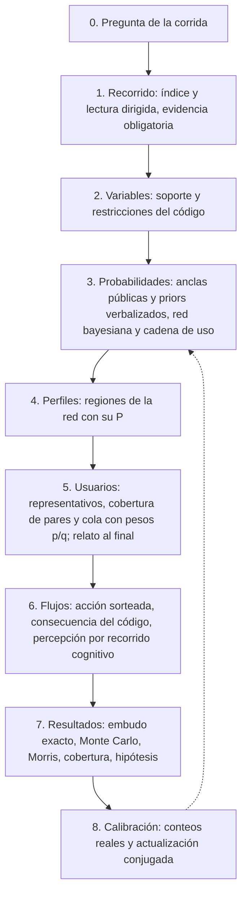

# Statfish: análisis de viabilidad

| | |
|---|---|
| Fecha | 2026-11-20 |
| Estado | Primer enfoque. Sin código de producto; el caso de prueba se hizo a mano, con un agente y scripts desechables. |
| Caso de prueba | La landing de Volutus, `VolutusDevelopment/VolutusLandingPage` @ `76b713a`: [caso-volutus/](caso-volutus/recorrido.md) |

## Veredicto

**Avanzar, con condiciones.**

Lo viable, con evidencia del caso:

- **Un solo agente recorre el código y saca un mapa útil.** Leyó cerca del 11 % de los bytes, unos 65 a 70 mil tokens.
  Encontró 19 reglas con evidencia `archivo:línea` y 5 fricciones nuevas que ni el issue #40 ni la v0 de 100.000 perfiles
  habían visto. Una es una pérdida silenciosa de briefs de clientes con respuesta de éxito.
- **El modelo probabilístico es barato y auditable.** Calcula el desenlace de 120.000 usuarios en segundos, sin LLM, con
  intervalos, sensibilidad y una hipótesis de qué pasa si se cambia el código. Es reproducible con semilla.
- **«Abarcar de todo» se puede medir.** 34 usuarios cubrieron 514 de 514 pares de valores de 13 factores, 61 de 61
  arcos del flujo y 35 de 37 superficies.

Lo que no es viable todavía:

- **Predecir niveles.** El 74 % que se va sin intentar y el 23,6 % de contacto salen de priors de intención que el código
  no puede informar. Es el mismo límite de la v0: «el modelo describe a los clientes que imaginé».

Las condiciones para avanzar:

1. Presentar todo resultado como **prior con intervalo y evidencia**, nunca como pronóstico.
2. Prever **calibración** desde el diseño: contadores sin datos personales y actualización conjugada.
3. Sumar una **fase dinámica** (Playwright) para lo que solo existe en ejecución, como la carrera de Turnstile.
4. Pasar los [criterios del PoC](#criterios-para-un-poc) en al menos dos repositorios.

## Qué es Statfish

**Definición operativa.** Un agente recorre el código de un producto y deja tres cosas:

1. El **soporte**: qué variables de usuario y de entorno existen y qué valores admiten.
2. Las **restricciones duras**: qué combinaciones son imposibles.
3. Las **reglas**: qué consecuencia tiene cada acción.

Sobre eso se monta un modelo probabilístico, con P(perfil) y P(flujo | perfil). De él se crean usuarios que recorren el
producto. El LLM se usa donde rinde, que es leer código, verbalizar distribuciones y juzgar la percepción de un paso. No
se usa donde falla, que es muestrear y predecir acciones.

### Por qué este flujo y no otro

| Etapa | Técnica elegida | Evidencia | Lo que se descartó |
|---|---|---|---|
| 1. Recorrido | Primero un índice estructural y después lectura dirigida por la pregunta; `archivo:línea` obligatorio | LocAgent y RepoGraph: el grafo del código mejora la localización (92,7 % a nivel de archivo en LocAgent) | Leer el repo entero sin índice |
| 2. Variables | El código da el soporte y las restricciones (probabilidad 0) | El caso: el código mostró lo posible, no lo probable | Que el LLM invente el dominio |
| 3. Probabilidades | Anclas públicas para las marginales. El LLM **verbaliza** la distribución (p10, p50, p90) y no muestrea. Se juntan K elicitaciones en una mezcla y una Dirichlet. | Meister et al. (NAACL 2025): el LLM describe mejor una distribución de lo que muestrea de ella. Evi-DA (2026): la verbalización se ancla a la forma de la pregunta, así que conviene evidencia. AutoElicit (ICML 2025): mezcla de priors actualizable. | Pesos a ojo, como en la v0; pesos uniformes, el modelo nulo de la v0; pedirle al LLM que genere usuarios |
| 4. Perfiles | Partición de la red en regiones con masa | Perfil operacional de Musa (1993) | Arquetipos escritos a mano |
| 5. Usuarios | Primero la estructura (sorteo con semilla) y después el relato. Cobertura de pares con restricciones; pesos p/q. | «LLM Generated Persona is a Promise with a Catch» (NeurIPS 2025): más contenido inventado, más sesgo. Kuhn y Wallace (2004) y NIST: entre el 50 y el 97 % de las fallas aparecen con uno o dos factores, según el estudio. | Que el LLM escriba la persona entera |
| 6. Flujos | Cadena de Markov de uso. La acción se sortea, la consecuencia sale del código y la percepción, de las 4 preguntas del recorrido cognitivo. | Whittaker y Thomason (1994). ShopCART (Lu et al. 2025): los LLM aciertan 11,86 % de las acciones reales y compran de más. Los recorridos cognitivos con LLM encuentran problemas reales, aunque no imitan a una persona. | Un enjambre de agentes que decide cada clic, como MiroFish o UXAgent |
| 7. Resultados | Absorción exacta por usuario; Monte Carlo sobre los parámetros; Morris (y Sobol si hace falta); robustez del orden | Saltelli y JASSS 17(3):11: Morris primero, Sobol después | Simular miles de usuarios con LLM para el agregado |
| 8. Calibración | Dirichlet-multinomial con conteos sin datos personales | La v0 ya proponía anotar etapa y motivo en cada consulta | Presentar priors como si fueran el mercado |

**Lo novedoso y lo incierto.** No encontré trabajos que generen perfiles **desde el código fuente**. Lo más cercano parte
de reseñas, de requisitos (PersonaGen) o de la aplicación en ejecución (AutoE2E, con 79 % de cobertura de funciones).
Ese hueco es la diferencia de Statfish, y también su mayor incógnita.

## Comparación: MiroFish, la v0 de Volutus y Statfish

| | MiroFish | v0 de Volutus | Statfish |
|---|---|---|---|
| Qué simula | N agentes LLM con personalidad y memoria que interactúan en redes sociales (OASIS) durante R rondas | 100.000 perfiles con reglas y pesos explícitos, sin LLM | Usuarios sorteados de una red derivada del código; flujos por una cadena de uso |
| Semilla | Noticias y documentos, con GraphRAG y memoria en Zep | El texto de una página | El código entero |
| Para qué usa el LLM | Cada acción de cada agente, más el informe | Nada | Leer código, verbalizar priors, juzgar la percepción de un paso, escribir el relato |
| El costo escala con | N × R | Nada (local) | El tamaño del código y los usuarios con relato; la población cuesta 0 |
| Reproducible | No: dos corridas dan resultados distintos | Sí (semilla 20261017) | Sí (semilla 20261120) |
| Probabilidad explícita | No | Sí | Sí, con intervalos |
| Interacción entre usuarios | Sí: opinión, contagio | No | No |
| Trazabilidad | Del informe a las respuestas de los agentes | De la duda al texto de la página | De la fricción a `archivo:línea` |
| Validación publicada | Ninguna. En la prueba de WPP (mayo de 2026), el enjambre dio lo mismo que una sola llamada al modelo. | Fidelidad, modelo nulo y sensibilidad | Fidelidad, robustez del orden, Morris y cobertura; falta la validación externa |
| Responde mejor | «¿Cómo reaccionaría la gente a X?», en exploración | «¿Qué dudas de negocio frenan?» | «¿Quién no logra qué, en qué paso y por qué, y qué cambia si cambio el código?» |

Statfish y MiroFish no compiten en todo. Si una pregunta necesita interacción social, la población de Statfish, con sus
pesos, puede ser la semilla de personas de un MiroFish. Y la v0 aporta lo que el código no ve: el catálogo de dudas de
negocio.

## El modelo probabilístico

1. **Soporte, pesos y calibración, separados.** El código fija lo posible. Las anclas y los priors fijan lo probable.
   Los datos, cuando existan, corrigen.
2. **P(perfil): una red bayesiana chica**, con dependencias declaradas: canal → dispositivo → sistema → navegador, tamaño
   → servicio, canal → etapa, y así. Los nodos sin ancla llevan una Beta o una Dirichlet ajustada al p10–p90 verbalizado.
   Las variables que el código no usa (rubro, región, edad) son **de relato** y no tocan el flujo.
3. **P(flujo | perfil): una cadena de Markov de uso**, con estados de página y formulario, arcos condicionados al usuario
   y desenlaces absorbentes. La probabilidad de cada desenlace se calcula **exacta** por usuario; no hace falta simular.
4. **Tres muestreadores**:
   - representativo, ancestral;
   - cobertura de pares con restricciones (AETG con candidatos de una red aplanada);
   - cola, con peso de importancia p/q para reponderar.
5. **Flujo, en tres partes por paso**: la acción se sortea, la consecuencia la da la regla del código con evidencia y la
   percepción sale del recorrido cognitivo. Las fricciones encontradas corrigen P.
6. **Incertidumbre y sensibilidad.** Monte Carlo sobre los parámetros (p5–p95), Morris para ordenar los supuestos y
   robustez del orden de las fricciones entre sorteos. El supuesto con más μ* es el que más vale reemplazar por un dato.
7. **Calibración.** Beta-binomial y Dirichlet-multinomial con conteos reales. La diferencia entre prior y posterior mide
   cuánto dependía el resultado de los supuestos.

El detalle del caso está en [modelo](caso-volutus/modelo.md).

## Costos

Lo medido en el caso: el recorrido leyó **unos 235 KB, 65 a 70 mil tokens de contenido**, en un repositorio de 2,15 MB.
Lo que sigue son estimaciones con los precios de Claude por millón de tokens, según la tabla del skill `claude-api` en
caché del 2026-11-03:

| Modelo | Entrada | Salida | Lectura de caché | Escritura de caché (5 min) |
|---|---|---|---|---|
| Opus 5.5 | $4 | $20 | $0,20 | $5 |
| Sonnet 5.5 | $2 | $10 | $0,10 | $2,50 |
| Haiku 5.5 | $0,10 | $0,50 | ≈ $0,01 | ≈ $0,125 |

**Statfish, una corrida sobre un repositorio como este.** Supuestos: unas 40 vueltas de agente con el contexto creciendo
hasta unos 100 mil tokens, casi todo leído de caché; K = 5 elicitaciones; recorridos cognitivos solo en los pasos con
fricción.

| Etapa | Entrada (M tokens) | Salida (M) | Opus 5.5 | Sonnet 5.5 |
|---|---|---|---|---|
| Recorrido | 2,2 de caché + 0,15 escritos + 0,05 nuevos | 0,08 | ≈ $3,0 | ≈ $1,5 |
| Elicitación (K = 5) | 0,1 de caché + 0,02 escritos | 0,02 | ≈ $0,5 | ≈ $0,3 |
| Recorridos cognitivos (≈ 100 pasos) | 3,0 de caché + 0,1 nuevos | 0,03 | ≈ $1,6 | ≈ $0,8 |
| Relato de 34 usuarios | 0,05 | 0,015 | ≈ $0,5 | ≈ $0,3 |
| Red, cadena, Monte Carlo y Morris | 0 | 0 | $0 | $0 |
| **Total** | **≈ 5,5** | **≈ 0,15** | **≈ $5,6** | **≈ $2,8** |

**Un MiroFish con Claude, como vara común.** MiroFish recomienda Qwen-plus y además cobra Zep, así que esto solo compara
órdenes de magnitud. Supuestos: cada acción de un agente lleva unos 5 mil tokens de entrada (persona, memoria y feed) y
300 de salida, sin caché útil porque el feed cambia en cada ronda.

| Escenario | Llamadas | Entrada | Salida | Opus 5.5 | Sonnet 5.5 | Haiku 5.5 |
|---|---|---|---|---|---|---|
| 100 agentes × 40 rondas | 4.000 | 20 M | 1,2 M | $104 | $52 | $2,6 |
| 1.000 agentes × 40 rondas | 40.000 | 200 M | 12 M | $1.040 | $520 | $26 |

**La diferencia es de forma, no solo de nivel.** El costo de Statfish depende del tamaño del código y de cuántos usuarios
llevan relato y recorrido cognitivo, unos $0,04 por usuario con Opus 5.5. Los 120.000 usuarios del agregado costaron 0
tokens. El de MiroFish crece con agentes × rondas. Un repositorio diez veces más grande debería costarle a Statfish de
5 a 10 veces más en la etapa de recorrido, no 10 veces en todo, porque la lectura es dirigida. Es una hipótesis a medir
en el PoC.

## Evidencia del caso Volutus

- **Recorrido**: [caso-volutus/recorrido.md](caso-volutus/recorrido.md).
  - 19 reglas con evidencia y 4 hipótesis que el código descartó.
  - El sitio no declara token de origin trial para WebMCP.
  - Una inconsistencia de documentación sobre el brief.
- **Modelo**: [caso-volutus/modelo.md](caso-volutus/modelo.md).
  - 21 variables de flujo y 3 de relato.
  - Anclas de StatCounter, SII e INE.
  - 6 restricciones duras.
  - Una cadena de uso con 61 arcos.
- **Perfiles**: 8 segmentos con su P(perfil) e intervalo ([caso-volutus/perfiles.md](caso-volutus/perfiles.md)).
- **Usuarios y flujos**: [caso-volutus/usuarios-y-flujos.md](caso-volutus/usuarios-y-flujos.md).
  - 34 usuarios: 12 representativos y 22 de cobertura con peso p/q.
  - 34 trazas sorteadas y 30 forzadas para cubrir arcos.
- **Resultados**: [caso-volutus/resultados.md](caso-volutus/resultados.md).
  - Pérdida por código de 1,27 % de las llegadas (0,65 a 2,11).
  - Cuatro fricciones principales con un orden robusto.
  - Una pérdida silenciosa (R21).
  - Arreglar las cuatro fricciones principales baja la pérdida a 0,42 %.
- **Issues** en el repositorio de la landing:
  - [#74](https://github.com/VolutusDevelopment/VolutusLandingPage/issues/74): brief sin JS, pérdida silenciosa.
  - [#75](https://github.com/VolutusDevelopment/VolutusLandingPage/issues/75): validación del nombre.
  - [#76](https://github.com/VolutusDevelopment/VolutusLandingPage/issues/76): carrera de Turnstile.
  - [#77](https://github.com/VolutusDevelopment/VolutusLandingPage/issues/77): doble ruta de «Cuéntanos tu proyecto».
  - [#78](https://github.com/VolutusDevelopment/VolutusLandingPage/issues/78): cotización desde `/ley21719`.

## Riesgos y mitigaciones

| Riesgo | Cómo apareció en el caso | Mitigación |
|---|---|---|
| **El código no es la población** | El 74 % que se va sin intentar y el contacto total salen de priors de intención | Separar soporte, pesos y calibración. Reportar intervalos. No vender niveles. Calibrar con conteos. |
| **Sesgo y homogeneización de los priors del LLM** | Canal, etapa y tamaño sin ancla directa | Anclas públicas; distribución verbalizada con rango; K elicitaciones en mezcla; estructura antes que relato; Morris para ver qué pesa |
| **Un solo agente no da elicitaciones independientes** | En el caso solo hay rangos | En el PoC: K llamadas con contexto limpio y preguntas reformuladas, quizás con modelos distintos; medir la estabilidad |
| **Reglas inventadas** | Tres hipótesis plausibles resultaron falsas (los 8 s al volver, el token vencido, la GPU) | Evidencia `archivo:línea` obligatoria y verificada automáticamente; una regla sin cita no entra al modelo |
| **Lo que solo existe en ejecución** | R4 (carrera de Turnstile) y R6 (WhatsApp en una app) dependen de tiempos y del dispositivo | Fase dinámica: Playwright contra un build local con correo y Turnstile simulados; confirmar en un dispositivo real |
| **Explosión combinatoria** | 13 factores dan 514 pares | Cobertura por pares con restricciones; 3 a 6 factores donde haya interacción conocida; pesos p/q |
| **Repositorios grandes** | Aquí bastó leer el 11 % | Índice estructural (tree-sitter, grafo tipo LocAgent) y lectura guiada por la pregunta; medir costo y recall en un repo grande |
| **Sin interacción social** | No hay dinámica de opinión | Fuera de alcance; si hace falta, Statfish como generador de población para un MiroFish |
| **Privacidad del código** | Se manda código a una API | Revisar secretos antes; retención mínima; opción local |
| **Licencia** | MiroFish es AGPL-3.0 | No reutilizar su código: Statfish toma solo la idea. Si algún día se reutiliza, aceptar la AGPL. |
| **Sin validación externa** | Ninguna en el caso | Contadores en el Worker; un repositorio con analítica para un backtest |

## Criterios para un PoC

| Métrica | Umbral | Cómo se mide |
|---|---|---|
| Recall de reglas y variables | ≥ 80 % | Contra una anotación manual en 2 o más repos. Este caso es la primera: 19 reglas y 21 variables. |
| Precisión de la evidencia | ≥ 95 % | Cada `archivo:línea` existe y respalda lo que se afirma (verificación automática más revisión) |
| Hallazgos útiles | ≥ 3 confirmados por el equipo en cada repo; ≤ 20 % de falsos positivos | Issues aceptados contra issues abiertos |
| Estabilidad entre corridas | Divergencia de Jensen-Shannon ≤ 0,05 por categórica; las mismas 3 fricciones principales en ≥ 80 % de las corridas | 5 corridas independientes |
| Cobertura | 100 % de los pares de los factores declarados; 100 % de los arcos; ≥ 90 % de las superficies, por clase | Script de cobertura |
| Costo | ≤ USD 10 y ≤ 30 min por corrida en un repo de unos 2 MB | `usage` de la API |
| Plausibilidad de las fichas | ≥ 4 de 5 según dos revisores | Rúbrica |
| Calibración, si hay datos | Mejor que el modelo nulo (pesos uniformes) en KS o Brier | Conteos del Worker o analítica |

## Próximos pasos

1. **Índice estructural.** Tree-sitter para rutas, formularios, handlers, validaciones y flags. El agente recibe el índice
   y lee solo lo necesario. Salida: el mapa en JSON con evidencia.
2. **Elicitación.** K = 5 llamadas independientes con la distribución en JSON (p10, p50, p90) y anclas automáticas por
   país (StatCounter, SII, INE). Para respuestas tipo escala existe además el método SSR (Maier et al. 2025), que logra
   el 90 % de la fiabilidad humana.
3. **Motor estadístico.** Red, cadena de uso, muestreadores, Monte Carlo, Morris y cobertura, en Python. Es lo de este
   caso, convertido en biblioteca.
4. **Fase dinámica.** Playwright contra un build local con Resend y Turnstile simulados, para confirmar las reglas de
   tiempo (R4) y de entorno.
5. **Recorrido cognitivo con LLM** solo en los pasos con fricción, citando la evidencia.
6. **Validar.** En Volutus, con este caso como referencia anotada. En otro repositorio que tenga analítica, para un
   backtest.
7. **Sumar el catálogo de dudas de la v0** como frenos de contenido en el paso «¿Escribe?».

## Fuentes

- MiroFish: [repositorio](https://github.com/666ghj/MiroFish) · [prueba de WPP](https://cms.research.wpp.com/?research_feed=mirofish-is-swarm-intelligence-worth-the-cloud-bill) · [revisión independiente](https://pasqualepillitteri.it/en/news/21443/does-mirofish-really-work-agent-swarm-alternatives)
- LLM como usuarios: [ShopCART, Lu et al. 2025](https://arxiv.org/abs/2503.20749) · [UXAgent](https://arxiv.org/abs/2502.12561) · [Generative Agent Simulations of 1,000 People](https://arxiv.org/abs/2411.10109)
- Distribuciones y priors: [Meister et al., NAACL 2025](https://arxiv.org/abs/2411.05403) · [Evi-DA](https://arxiv.org/pdf/2603.13305) · [AutoElicit, ICML 2025](https://arxiv.org/abs/2411.17284) · [Wisdom of the silicon crowd](https://www.science.org/doi/10.1126/sciadv.adp1528) · [SSR, Maier et al. 2025](https://arxiv.org/abs/2510.08338)
- Personas sintéticas: [Promise with a Catch, NeurIPS 2025](https://arxiv.org/abs/2503.16527) · [revisión de 81 artículos](https://arxiv.org/abs/2504.04927) · [Verbalized Sampling](https://arxiv.org/abs/2510.01171) · [LLM en ingeniería de requisitos](https://arxiv.org/html/2509.11446v1)
- Pruebas estadísticas y combinatorias: [Whittaker y Thomason 1994](https://www.site.uottawa.ca/~gvj/papers/Software%20Engineering%20IEEE%20Transactions%20on%201994%20Whittaker.pdf) · Musa, «Operational profiles in software-reliability engineering», IEEE Software, 1993 · [perfil operacional, ACM Computing Surveys](https://dl.acm.org/doi/abs/10.1145/2518106) · [Kuhn, NIST](https://tsapps.nist.gov/publication/get_pdf.cfm?pub_id=910001)
- Código y agentes: [LocAgent](https://arxiv.org/abs/2503.09089) · [RepoGraph](https://github.com/ozyyshr/RepoGraph) · [AutoE2E](https://arxiv.org/abs/2408.01894)
- Población sintética: [red bayesiana + IPF](https://github.com/vdarsel/Synthetic-Population-Forecasting_BN-IPF_model) · [síntesis con LLM](https://pmc.ncbi.nlm.nih.gov/articles/PMC13229344/)
- Sensibilidad: [JASSS 17(3):11](https://jasss.soc.surrey.ac.uk/17/3/11.html)
- Recorrido cognitivo con LLM: [Synthetic Cognitive Walkthrough](https://arxiv.org/pdf/2512.03568) · [GenderMag con agentes](https://dl.acm.org/doi/full/10.1145/3801978)
- Anclas: StatCounter Chile, oct-2026 ([plataforma](https://gs.statcounter.com/platform-market-share/desktop-mobile-tablet/chile), [celular](https://gs.statcounter.com/os-market-share/mobile/chile), [escritorio](https://gs.statcounter.com/os-market-share/desktop/chile), [navegador](https://gs.statcounter.com/browser-market-share/all/chile)) · [SII](https://www.sii.cl/sobre_el_sii/estadisticas_de_empresas.html) · [INE 2025](https://www.cnnchile.com/negocios/ine-registra-1207333-empresas-activas-chile-2025-alza-39/) · [BCN 2026](https://obtienearchivo.bcn.cl/obtienearchivo?id=repositorio%2F10221%2F38964%2F1%2FTamano_de_empresas.pdf)
- Entorno: [Turnstile, configuración del widget](https://developers.cloudflare.com/turnstile/get-started/client-side-rendering/widget-configurations/) · [Smart Punctuation en iPhone](https://ladedu.com/what-smart-punctuation-does-on-an-iphone/) · [un caso de validación rota por `’`](https://github.com/candrikanich/recruiting-compass-ios/pull/281) · estado de WebMCP: [nohacks](https://nohacks.co/blog/what-is-webmcp) y [Spronta](https://www.spronta.com/blog/state-of-webmcp-july-2026/)
- Precios de Claude: tabla del skill `claude-api` (caché del 2026-11-03)
