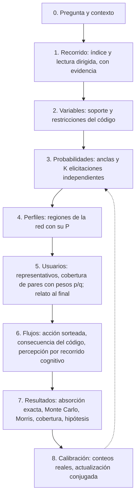

# El método: por qué cada etapa

Statfish separa tres cosas. El código fija lo **posible** (soporte y restricciones). Las anclas y los priors
fijan lo **probable**. Los datos, cuando existen, **corrigen** (calibración).

El LLM se usa donde rinde: leer código, verbalizar distribuciones, juzgar la percepción de un paso y
escribir el relato. No se usa donde falla: muestrear usuarios y predecir acciones.

| Etapa | Técnica | Por qué esta y no otra | Fuente |
|---|---|---|---|
| 1. Recorrido | Primero un índice estructural y después lectura dirigida; `archivo:línea` con extracto, siempre | El grafo del código mejora la localización (92,7 % a nivel de archivo). Sin evidencia, el agente inventa reglas plausibles: en el caso Volutus, tres resultaron falsas. | LocAgent, RepoGraph |
| 2. Variables | El código da el soporte y las restricciones (probabilidad 0) | El código muestra lo posible, no lo probable. Que el LLM invente el dominio mezcla las dos cosas. | Caso Volutus |
| 3. Probabilidades | Anclas públicas para las marginales; para el resto, el LLM **verbaliza** p10, p50 y p90 en K = 5 llamadas independientes, que se juntan en una mezcla (F3) | El LLM describe una distribución mejor de lo que muestrea de ella. La verbalización se ancla a la forma de la pregunta, así que conviene darle evidencia. La mezcla de priors es actualizable. | Meister et al. (NAACL 2025), Evi-DA (2026), AutoElicit (ICML 2025) |
| 4. Perfiles | Partición de la red en regiones con masa | El perfil operacional: probar en proporción al uso | Musa (1993) |
| 5. Usuarios | Primero la estructura (sorteo con semilla) y después el relato. Cobertura de pares con restricciones (AETG) y pesos p/q. | Cuanto más inventa el LLM sobre una persona, más se sesga. Entre el 50 y el 97 % de las fallas aparecen con uno o dos factores. | «LLM Generated Persona is a Promise with a Catch» (NeurIPS 2025); Kuhn y Wallace (2004), NIST |
| 6. Flujos | Cadena de Markov de uso. La acción se sortea, la consecuencia sale del código y la percepción, de las 4 preguntas del recorrido cognitivo. | Los LLM aciertan el 11,86 % de las acciones reales y compran de más. El recorrido cognitivo con LLM encuentra problemas reales aunque no imite a una persona. | Whittaker y Thomason (1994); ShopCART (Lu et al. 2025); Wharton et al. |
| 7. Resultados | Absorción exacta por usuario (F7), Monte Carlo sobre los parámetros (F9), Morris (F10), robustez del orden (F11), hipótesis como cambios de parámetros | Simular miles de usuarios con LLM para el agregado es caro y no reproducible. Morris primero, Sobol si hace falta. | Saltelli; JASSS 17(3):11 |
| 8. Calibración | Beta-binomial y Dirichlet-multinomial con conteos sin datos personales (F14) | La diferencia entre prior y posterior mide cuánto dependía el resultado de los supuestos | — |

## Lo que se descartó

| Alternativa | Por qué no |
|---|---|
| Pesos a ojo, como en la v0 de Volutus | El orden de los resultados dependía de los pesos asignados |
| Pesos uniformes | Es el modelo nulo; sirve de comparación, no de prior |
| Pedirle al LLM que genere usuarios o personas enteras | Homogeneiza y sesga |
| Un enjambre de agentes que decide cada clic, como MiroFish o UXAgent | Caro (crece con agentes × rondas), no reproducible y sin validación publicada |
| Leer el repo entero sin índice | Caro, y no mejora el recall |

## Qué se puede afirmar y qué no

- **Sí:** qué fricciones existen (con evidencia), su **orden** y su robustez, quién las sufre, cuánto cambia
  el modelo si cambia el código (hipótesis) y qué supuesto conviene medir primero (Morris).
- **No sin datos:** los niveles absolutos (cuántos contactan, cuántos se van). Salen de priors de intención
  que el código no puede informar. Se presentan como prior con intervalo.

## Elicitación: qué darle al agente `elicitador`

Para cada parámetro sin ancla, el mensaje lleva cuatro cosas:

1. **Id y definición exacta:** de quién es la probabilidad y condicionada a qué.
2. **Evidencia:** `archivo:línea` con su extracto, y el ancla si informa algo.
3. **Contexto:** producto, país, público y pregunta de la corrida.
4. **El formato de salida**, que está en el propio agente.

Las K llamadas van en paralelo y sin respuestas previas: si una ve a otra, ya no son independientes. Con la
divergencia de Jensen-Shannon por encima de 0,05, la definición suele estar ambigua. Precísala antes de
promediar.

## Criterios del PoC

Del [análisis de viabilidad](../../../docs/viabilidad.md#criterios-para-un-poc) del repo:

- recall de reglas y variables ≥ 80 %, contra una anotación manual;
- precisión de la evidencia ≥ 95 % (`statfish evidencia`);
- divergencia de Jensen-Shannon ≤ 0,05 entre elicitaciones;
- 100 % de pares y de arcos, y ≥ 90 % de superficies por clase;
- costo ≤ USD 10 y ≤ 30 min por corrida en un repo de unos 2 MB.
